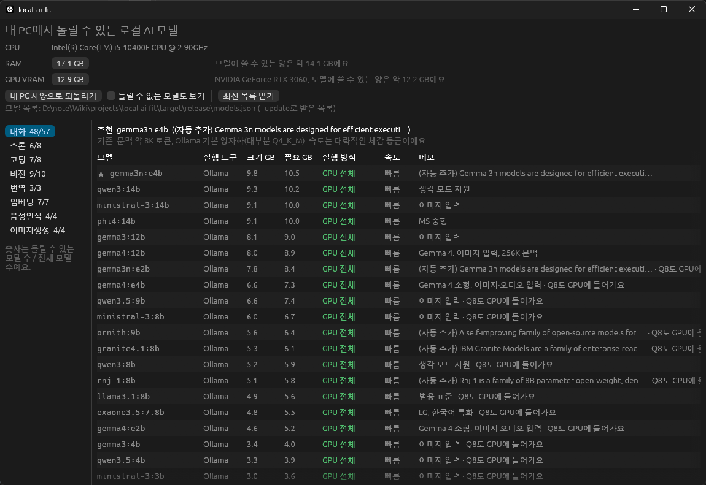

# local-ai-fit

내 PC 사양(RAM, GPU VRAM)을 자동으로 확인해서, 그 안에서 돌릴 수 있는 로컬 AI 모델을 분야별로 보여주는 Windows 프로그램(Rust). 창(GUI)과 명령줄(CLI) 두 가지로 쓸 수 있다.



- 분야: 대화, 추론, 코딩, 비전, 번역, 임베딩, 음성인식(whisper), 이미지생성(SD·FLUX)
- 모델마다 GPU 전체 / GPU+CPU 분할 / CPU / 불가와 대략적인 속도 등급, 분야별 추천 모델을 보여준다.
- RAM·VRAM 값을 바꿔 다른 PC 사양으로도 볼 수 있다.
- "벤치마크 비교" 탭: 모델을 최대 8개 골라 MMLU-Pro, GPQA Diamond, HLE, LiveCodeBench, AIME 2025, IFBench, MMMU-Pro, τ²-Bench, Terminal-Bench Hard, AA-LCR, SciCode 점수를 표와 막대로 비교한다. GPT·Claude·Gemini·Grok 같은 상용 모델 20개도 기준으로 함께 고를 수 있다(아래 "벤치마크 점수" 참고).
- "최신 목록 받기"(`--update`)로 Ollama 공식 레지스트리에서 모델 크기를 새로 받고 인기 있는 새 모델을 추가한다.
- 모델 목록·필요 사양 표: [MODELS.md](MODELS.md), 원본 데이터: [models.json](models.json)(빌드 때 exe에 포함)

## 빌드

필요한 것: [Rust](https://rustup.rs)와 MinGW-w64(GUI 의존성이 `dlltool`·`as`를 씀). MSVC 툴체인을 쓰면 MinGW 없이 빌드된다.

```bash
winget install BrechtSanders.WinLibs.POSIX.UCRT   # GNU 툴체인일 때만
cargo build --release
```

결과: `target/release/local-ai-fit-gui.exe`(창), `target/release/local-ai-fit.exe`(CLI). 둘 다 단독 실행 파일이라 다른 PC에 복사해도 동작한다.

## 설치 (일반 프로그램처럼 쓰기)

```bash
powershell -ExecutionPolicy Bypass -File install/install.ps1   # -NoDesktop: 바탕화면 바로가기 생략
```

- `%LOCALAPPDATA%\Programs\local-ai-fit`에 exe 2개 + `uninstall.ps1` 복사(관리자 권한 불필요).
- 시작 메뉴·바탕화면 바로가기 "Local AI Fit", 사용자 PATH 추가(새 터미널에서 `local-ai-fit`), 설정 > 앱 > 설치된 앱 등록(거기서 제거).
- 새 버전: 다시 빌드 후 install.ps1 재실행(실행 중인 창은 자동으로 닫고, 설치 폴더의 models.json은 유지).

## CLI

```bash
local-ai-fit            # 내 PC 기준
local-ai-fit --all      # 못 돌리는 모델도 표시
local-ai-fit --ram 32 --vram 8   # 다른 사양 가정 (--vram 0 = GPU 없음)
local-ai-fit --markdown > MODELS.md
local-ai-fit --update   # Ollama에서 최신 목록 받기(약 15초)
```

`--update`로 받은 목록은 exe 옆 `models.json`에 저장되고, 있으면 내장 목록 대신 쓴다. 지우면 내장 목록으로 돌아간다.

## 구조

- `src/lib.rs`: 사양 감지·판정(CLI·GUI 공용), `src/update.rs`: `--update`
- `src/main.rs`: CLI, `src/bin/local-ai-fit-gui.rs`: GUI(eframe/egui, 한글은 시스템 글꼴 맑은 고딕 사용)
- `assets/make_icon.py`: 아이콘 생성 → `build.rs`(embed-resource)가 exe에 넣음
- `install/`: 설치·제거 스크립트
- `scripts/fetch_benchmarks.py`: 벤치마크 점수 받기 → `benchmarks.json`

## --update 동작 (src/update.rs)

1. `ollama.com/library` HTML을 읽어 모델 이름·설명·기능 태그·크기 태그·다운로드 수·업데이트 시점을 뽑는다(공식 API 없음 → 사이트 구조가 바뀌면 `parse_library`만 고치면 됨).
2. 기존 Ollama 모델 + 새 후보(최근 1년 안 업데이트, 다운로드 50만 이상, `MIN_PULLS`)의 태그마다 공식 레지스트리 `registry.ollama.ai/v2/library/<이름>/manifests/<태그>`로 레이어 크기 합(GB)을, config blob의 `model_type`으로 파라미터 수를 받는다. 8개 병렬.
3. 기존 항목은 크기만 갱신(분야·메모·활성 파라미터는 유지). 새 항목은 분야를 이름·기능 태그로 추정하고, 활성 파라미터는 설명의 `A3B`/`3B active`/`activating 12B` 표기에서 찾는다. 메모는 영어 설명 앞부분에 "(자동 추가)"를 붙임.
4. 본체 digest가 같은 별칭 태그(예: `llama4:16x17b` = `llama4:scout`)와 클라우드 전용 모델(매니페스트 없음)은 건너뛴다.
5. 연결이 전혀 안 되면 저장하지 않고 종료 코드 1.

HTTP는 OS 기본 `curl`을 호출한다(Windows 10+ 기본 포함). Rust TLS crate(ring, OpenSSL)를 빌드할 C 컴파일러 없이도 되게 하려고.
레지스트리 크기는 모든 레이어 합이라 ollama.com 표시 범위의 위쪽 값과 같다(예: gemma4:26b 16→18.7GB). 안전한 쪽으로 계산된다.

CLI를 탐색기에서 더블클릭하면 결과를 보여주고 Enter를 기다린다.

## 판정 방식

- 필요 메모리 = 파일 크기(Ollama 기본 태그, 대부분 Q4_K_M) + 문맥 몫(`0.5 + 0.03×파라미터B`, 최대 4GB ≈ 8K 토큰). 임베딩·음성·이미지 모델은 `overhead` 값 직접 지정.
- 여유분: RAM은 OS 몫 3GB, VRAM은 화면·드라이버 몫 0.7GB를 뺀다.
- GPU 전체: 필요 ≤ VRAM → 빠름 / GPU+CPU 분할: 필요 ≤ VRAM+RAM / CPU: GPU 없음 + 필요 ≤ RAM / `gpu_only`(이미지 생성)는 VRAM에 들어가야만 가능.
- 속도 등급: MoE는 활성 파라미터만 읽으므로 분할·CPU에서도 한 단계 빠르게 본다. 실측 아님.
- 추천: 분야별로 GPU에 전부 올라가는 모델(없으면 실행 가능한 모델) 중 분야 점수가 가장 높은 것. 분야 점수(`rec_benches`): 대화 = GPQA·IFBench 평균, 코딩 = SciCode·Terminal-Bench Hard 평균, 비전 = MMMU-Pro, 그 밖 = GPQA. 하나라도 없으면 점수 없는 모델로 보고, 점수 있는 모델이 하나도 없을 때만 파라미터가 가장 큰 모델을 고른다. 파일 크기로 고르면 gemma3n처럼 인코더가 커서 파일만 큰 모델이 뽑히고, 파라미터를 점수보다 앞세우면 예전 대형 모델(qwen2.5-coder:32b 등)이 최신 모델을 이긴다.
- "Q8도 GPU에 들어감": 파라미터×1.07GB(+비전 인코더 등)로 Q8_0 크기를 추정해 VRAM에 들어가면 표시.

## 벤치마크 점수

- 출처: [Artificial Analysis](https://artificialanalysis.ai/models/open-source)가 직접 측정해 리더보드에 공개한 값. 모델 회사가 발표한 값이 아니라 같은 곳에서 같은 방식으로 잰 값이라 서로 비교하기 좋다.
- 현재 리더보드엔 지원 종료된 예전 모델(qwen3, gemma3, deepseek-r1 등)이 빠져 있어서, Wayback Machine에 남은 2025-12 ~ 2026-08 페이지로 채운다. 벤치마크마다 가장 최근 값을 쓴다.
- 원본(대부분 BF16) 모델 기준이다. Ollama 기본 양자화(Q4)로 돌리면 조금 낮을 수 있다.
- 생각(reasoning) 모드가 기본인 모델은 reasoning 점수를 쓴다(gpt-oss는 High). Ollama 기본 태그가 어느 판인지는 레지스트리 digest로 확인했다(예: `qwen3:4b` = Qwen3 4B 2507 Thinking).
- 모델마다 측정된 벤치마크가 달라 빈 칸이 있다. 예전 모델은 MMLU-Pro·LiveCodeBench·AIME가 있고, 최근 모델은 그 셋이 없다. GPQA·HLE·SciCode·AA-LCR·IFBench·τ²-Bench·Terminal-Bench Hard는 예전·최근 모두 있다(로컬 70개 중 62~69개).
- 벤치마크 고른 기준: AA가 모든 모델을 같은 방식으로 잰 것 중 예전 페이지(2025-12~)와 현재 페이지에 다 있어서 대부분 모델에 값이 있는 것. 한국어 벤치마크는 AA에 없어 넣지 못했다.
- 점수가 없는 모델(임베딩, 음성인식, 이미지 생성, exaone3.5 등)은 비교 탭에 나오지 않는다.
- 상용 모델: 최신 12개(Claude, GPT-6, Gemini, Grok)와 예전 참고용 8개(GPT-4o, o3, GPT-5, Claude 3.5·4 Sonnet, Gemini 2.5). 생각 수준을 고를 수 있는 모델은 가장 높은 설정 점수다. AA가 최신 상용 모델엔 HLE 등 일부 벤치마크만 공개해서 빈 칸이 많다. 처음 열면 내 PC 추천 모델 3개와 GPT-4o가 골라져 있다.
- 갱신: `python scripts/fetch_benchmarks.py` → `benchmarks.json`(빌드 때 exe에 포함). Ollama 태그 ↔ AA 모델 연결은 스크립트의 `MAPPING`, 상용 모델 목록은 `COMMERCIAL`에서 고친다. "최신 목록 받기"로 새로 추가된 모델도 `MAPPING`에 있어야 점수가 나온다(gemma3n, granite4.1, nemotron-3-nano 등은 넣어 둠).

## GPU 감지

| 환경 | 방법 |
|---|---|
| NVIDIA | `nvidia-smi` |
| Windows AMD/Intel | 레지스트리 `HardwareInformation.qwMemorySize` (WMI AdapterRAM은 4GB에서 잘림) |
| Linux AMD | `/sys/class/drm/*/device/mem_info_vram_total` |
| Apple Silicon | 통합 메모리의 70%를 GPU 몫으로 계산 |

VRAM 2GB 미만(내장 그래픽)은 GPU 없음으로 본다. GPU가 여러 개면 가장 큰 것 하나만 쓴다.

## 모델 추가

Ollama 모델은 `--update`가 알아서 추가한다. 손으로 넣을 때(Ollama 밖 모델, 분류·메모 다듬기)는 `models.json`에 한 줄 추가 후 다시 빌드. 자동 추가 항목을 다듬어 내장 목록에 반영하려면 exe 옆 파일에서 해당 줄을 옮겨오면 된다. 필드: `tag`, `cat`(대화/추론/코딩/비전/번역/임베딩/음성인식/이미지생성), `size`(GB), `params`·`active`(B, MoE만 active), `overhead`(GB, 선택), `runtime`(기본 Ollama), `gpu_only`, `note`.
크기는 `https://ollama.com/library/<이름>/tags`에서 확인. 데이터 기준일 2026-11-07.

## 비슷한 도구

- [llmfit](https://github.com/AlexsJones/llmfit): Rust TUI. 모델 수가 훨씬 많고 GPU 메모리 대역폭으로 속도(tok/s)를 추정한다. LLM 전용.
- [LLM Checker](https://github.com/Pavelevich/llm-checker): Node.js CLI, Ollama 명령까지 추천.
- 웹 계산기: [Can You Run This LLM?](https://apxml.com/tools/vram-calculator), [Hugging Face "Can I run it?"](https://huggingface.co/spaces/Vokturz/can-it-run-llm) 등. 사양을 직접 입력해야 한다.

이 프로젝트는 한국어 화면, 설치형 Windows 창 프로그램, LLM 밖의 음성인식·이미지 생성 모델까지 함께 판정하는 쪽에 초점을 둔다.

## 라이선스

MIT. [LICENSE](LICENSE) 참고.
